# 🦷 Ecosistema autónomo de cotizaciones con IA · Clínica Dental

**Entrega Final · IA Automation (Coderhouse) · Arian Young**

Un correo de un paciente que pide precio llega a Gmail. El sistema lo registra en Airtable, Claude lo clasifica contra la lista de precios y redacta la cotización, recepción la **aprueba en Slack** y la respuesta sale **en el mismo hilo de Gmail**. Nada sale al paciente sin aprobación humana, y cualquier fallo queda registrado y alertado.

> Caso de negocio ficticio (Clínica Dental Sonrisa Plena). Todos los datos de pacientes son de prueba.

---

## 🔗 Enlaces de la entrega

| Qué | Enlace |
|---|---|
| 📊 **Dashboard de control** (Shared View pública: KPIs y tasa de error) | https://airtable.com/appWFhwc5ePm9gC1Q/shrhSWFJYrNLM9rrK/tblf1nP87oWaD1zGa |
| 🗄️ **Base de datos en modo lectura** (Solicitudes) | https://airtable.com/appWFhwc5ePm9gC1Q/shrI2MSGkeEjIa0yG (vista sin datos de contacto) |
| 🎬 **Video demo (3 min)** | [`video/video_demo.mp4`](video/video_demo.mp4): cotización de punta a punta en vivo (correo → IA → aprobación en Slack → respuesta en Gmail → dashboard) |
| 🧩 Flujo principal (n8n JSON) | [`workflows/flujo_principal_cotizaciones.json`](workflows/) |
| 🧯 Manejador global de errores (n8n JSON) | [`workflows/manejador_global_errores.json`](workflows/) |

---

## 🧱 Stack (las 4 categorías obligatorias)

| Capa | Herramienta | Rol |
|---|---|---|
| **Corazón** · orquestador | **n8n Cloud** | Flujo principal (36 nodos) + Error Workflow |
| **Cerebro** · base de datos | **Airtable** | 5 tablas vinculadas: Solicitudes, Pacientes, Procedimientos, Log de Errores, KPIs |
| **Procesamiento IA** | **Anthropic Claude** | Haiku 4.5 clasifica (JSON) · Sonnet 5.5 redacta |
| **Voz** · salida | **Gmail + Slack** | Gmail responde al paciente en el mismo hilo · Slack #recepcion para HITL y alertas |

---

## ✅ Los 5 criterios de evaluación

| # | Criterio (20 % c/u) | Dónde está |
|---|---|---|
| 1 | **Mapa de arquitectura** | [`docs/01_Diagrama_Arquitectura.pdf`](docs/01_Diagrama_Arquitectura.pdf): diagrama de arquitectura + capturas del flujo real en n8n (5 páginas) |
| 2 | **Estructuras de datos documentadas** (tablas vinculadas + JSON de transferencia) | [`docs/02_Manual_Operativo_Datos.md`](docs/02_Manual_Operativo_Datos.md) + [`schemas/`](schemas/) |
| 3 | **Optimización de costos** (matriz de modelo por tarea + ahorro) | [`docs/03_Matriz_Costos.md`](docs/03_Matriz_Costos.md) |
| 4 | **Seguridad y resiliencia** (minimización + Error Handlers + HITL) | [`docs/04_Seguridad_Resiliencia.md`](docs/04_Seguridad_Resiliencia.md) |
| 5 | **Dashboard de control** (Shared View con 3+ KPIs) | [`docs/05_Dashboard_Control.md`](docs/05_Dashboard_Control.md) + enlace arriba |

---

## 1️⃣ Arquitectura

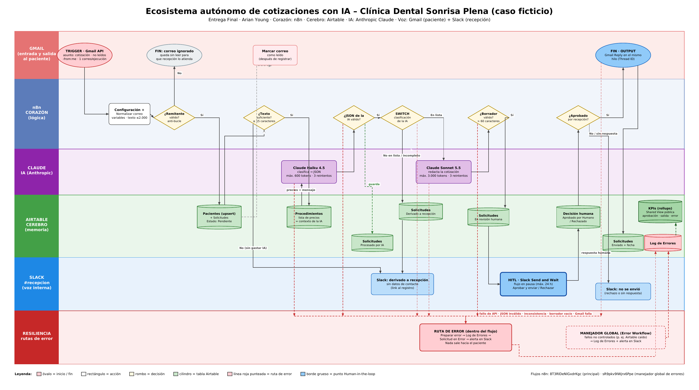

**Flujo resumido:**

1. **Trigger Gmail.** Solo correos no leídos con "cotización" en el asunto, que no sean propios, uno por ejecución.
2. **Anti-bucle.** Descarta respuestas "Re:" y remitentes no-reply.
3. **Registro en Airtable.** Paciente (upsert) y solicitud en estado `Pendiente`. Después de registrar, el correo se marca como leído.
4. **Validación sin IA.** Si el correo no tiene texto suficiente, se deriva a recepción sin gastar tokens.
5. **Claude Haiku.** Compara el mensaje con la lista de precios de Airtable y devuelve un JSON. Se valida, y la solicitud pasa a `Procesado por IA`.
6. **Switch.** Si está **En lista**, Claude Sonnet redacta. Si está **No en lista** o los **datos están incompletos**, se deriva a recepción por Slack.
7. **🚦 HITL en Slack.** El flujo se pausa hasta 24 h y recepción aprueba o rechaza.
8. **Si se aprueba.** Gmail responde en el **mismo hilo (Thread ID)** y la solicitud pasa a `Enviado`.
9. **Cualquier fallo.** Reintentos, Log de Errores, estado `Error` y alerta en Slack.

## 2️⃣ Datos

**Relaciones:** `Pacientes 1─N Solicitudes N─1 Procedimientos` · `Solicitudes 1─N Log de Errores` · `KPIs 1─N Solicitudes/Errores`

**Estados:** `Pendiente → Procesado por IA → En revisión humana → Aprobado por Humano / Rechazado → Enviado`, más `Derivado a recepción` y `Error`.

**Ejemplo del JSON que devuelve la IA** (los 7 esquemas están en [`schemas/`](schemas/)):

```json
{
  "clasificacion": "En lista",
  "procedimiento_detectado": "blanqueamiento dental",
  "procedimiento_lista": "Blanqueamiento dental",
  "razonamiento": "El paciente solicita explícitamente blanqueamiento dental, que coincide con un procedimiento activo de la lista."
}
```

**Ejemplo de la respuesta del HITL (Slack → n8n):**

```json
{ "data": { "approved": true, "respondedAt": "2026-10-07T15:08:12.000Z" } }
```

## 3️⃣ Costos (resumen)

| Tarea | Modelo | Costo real medido |
|---|---|---|
| Clasificar (mecánica) | Claude Haiku 4.5 | $0,00129 por solicitud |
| Redactar (lo lee el cliente) | Claude Sonnet 5.5 | $0,00823 por solicitud |
| Reporte mensual masivo (no urgente) | Sonnet vía **Message Batches** | −50 %: $0,72 en vez de $1,44 |

**Costo mensual estimado** (300 correos al mes): **$1,83**.
- Contra usar Sonnet en todo: **−16 %**.
- Contra usar Opus en todo: **−58 %**.

Prompt Caching se evaluó y se descartó por ahora: el prefijo mide ~750 tokens y el mínimo cacheable de Haiku 4.5 es de 4.096. El detalle está en el documento 3.

## 4️⃣ Seguridad y resiliencia (resumen)

- **Minimización.** La IA recibe solo el texto del correo y la lista de precios. Slack no recibe datos de contacto. El dashboard público solo muestra agregados.
- **Error Handlers.** Hay reintentos ×3, salidas de error en los nodos críticos, validación del JSON de la IA, una ruta de error con log y alerta, y un manejador global para fallos no controlados.
- **HITL.** Ninguna cotización sale sin el ✅ de recepción en Slack. Si no hay respuesta en 24 h, se trata como rechazo.
- **Anti-bucle, tipos estrictos, prompts dinámicos y configuración centralizada.** Sin datos hardcodeados.

## 5️⃣ Dashboard

[Abrir dashboard](https://airtable.com/appWFhwc5ePm9gC1Q/shrhSWFJYrNLM9rrK/tblf1nP87oWaD1zGa): tasa de aprobación, volumen de salida, tasa de error, solicitudes recibidas y tiempo promedio de respuesta.

---

## 🧪 Test de estrés: 7 ejecuciones reales

| # | Escenario | Resultado |
|---|---|---|
| 1 | Fallo real de la API de Claude | ✅ Ruta de error: log, estado Error y alerta en Slack |
| 2 | Blanqueamiento dental (ruta feliz) | ✅ Aprobado en Slack y respondido en el mismo hilo |
| 3 | Limpieza, **rechazada** por recepción | ✅ No se envió nada al paciente |
| 4 | "Hola" (datos incompletos) | ✅ Derivado sin gastar IA |
| 5 | Carillas + puente fijo (fuera de la lista) | ✅ Derivado a recepción |
| 6 | "Gracias por la info" (sin solicitud) | ✅ La IA lo detectó y lo derivó |
| 7 | Respuesta "Re:" en el hilo | ✅ Ignorado por el anti-bucle |

## 📸 Evidencias

| | |
|---|---|
| **HITL: el flujo en pausa esperando aprobación** 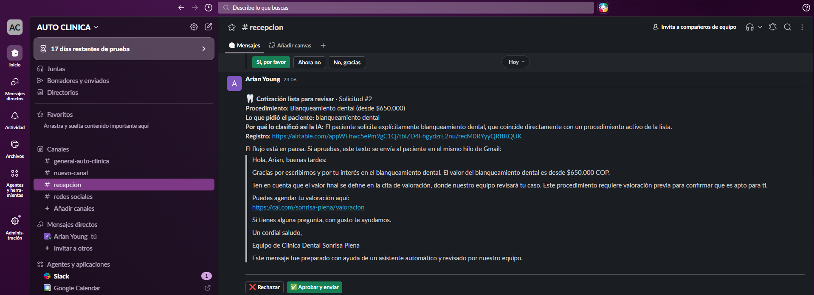 | **Respuesta en el mismo hilo de Gmail** 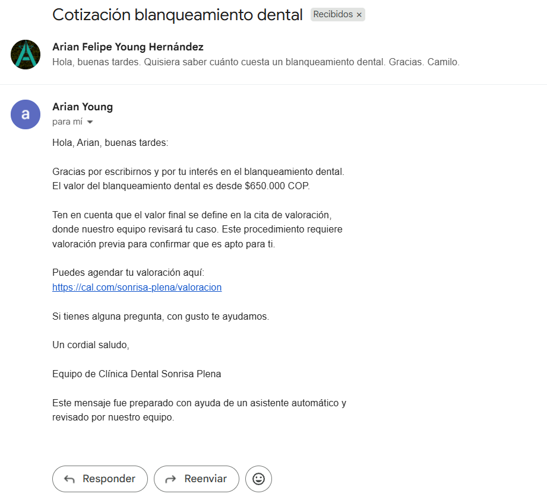 |
| **Rechazo humano: nada sale al paciente** 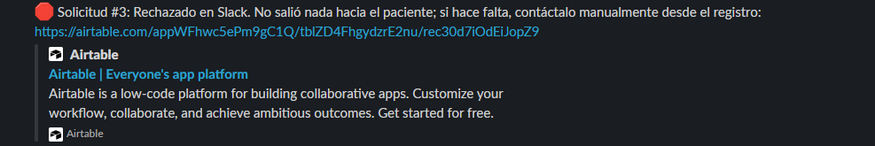 | **Ruta de error en producción** 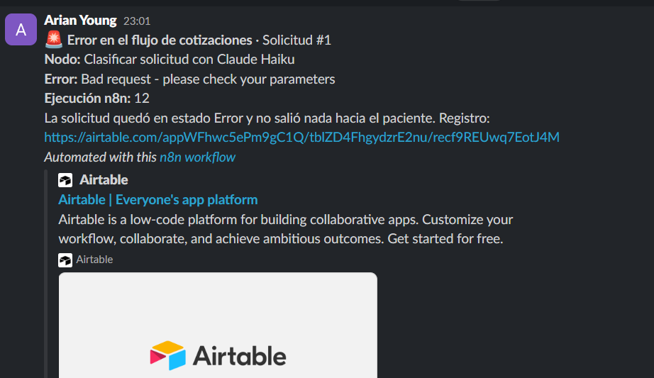 |
| **Derivaciones a recepción** 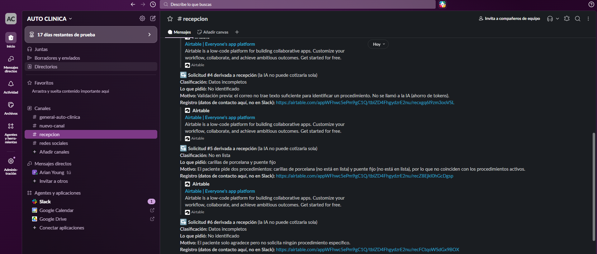 | **Dashboard abierto en incógnito** 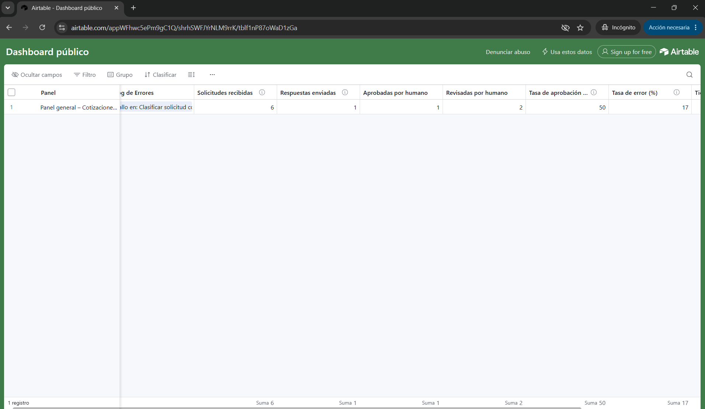 |

Capturas de n8n y Airtable:

**Flujo principal en n8n (vista completa)**
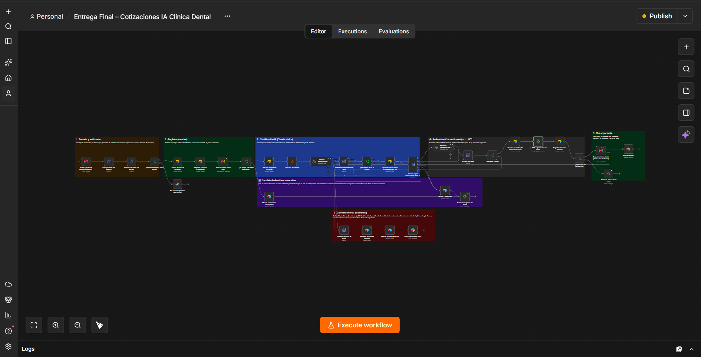

**Detalle de las etapas 1 a 3 y de los carriles de derivación y error**
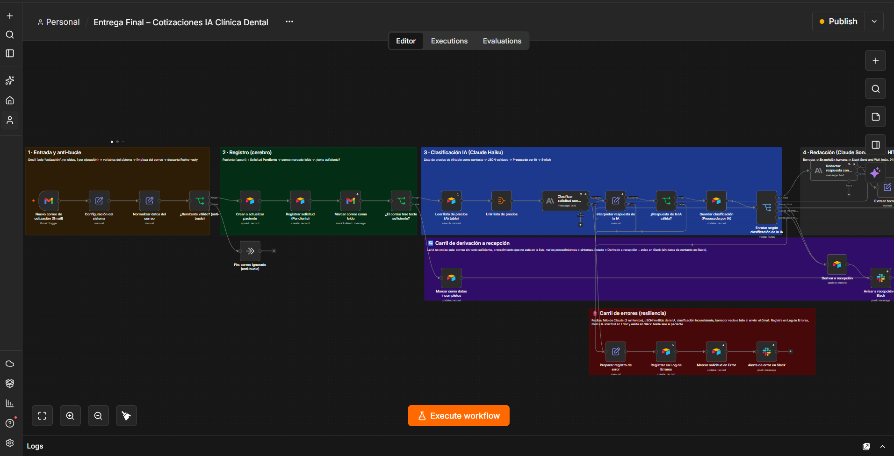

**Detalle de las etapas 4 y 5 (Sonnet, HITL y respuesta)**
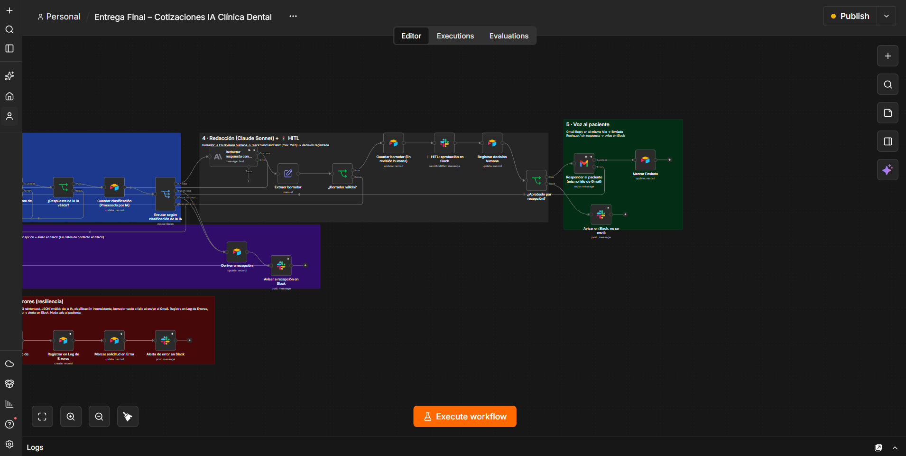

**Manejador global de errores (Error Workflow)**
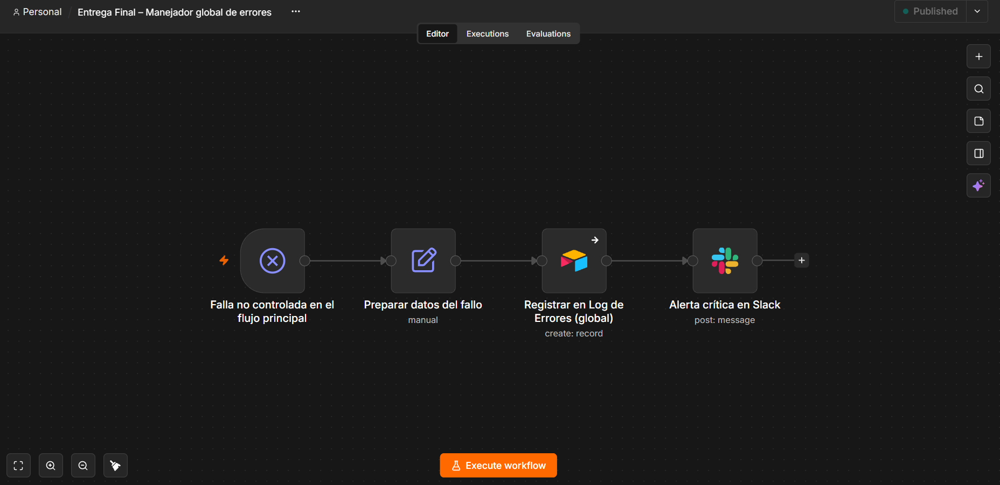

**Historial de ejecuciones en n8n.** Las ejecuciones con matraz 🧪 son pruebas con datos simulados; las demás son reales (trigger de Gmail). La de las 23:01:20 es el fallo real de la API de Claude: aparece como *Succeeded* porque la ruta de error lo atrapó y el flujo terminó de forma controlada (log, estado Error y alerta), en lugar de romperse. La única en rojo (22:23:10) es una prueba de la fase de construcción que detectó la falta de permiso de Airtable (403).
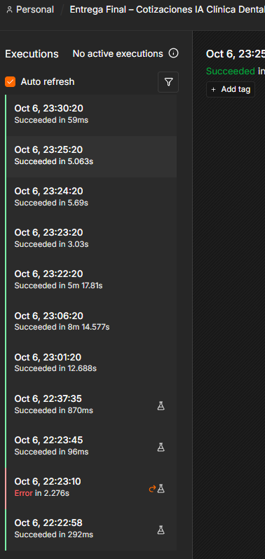

**Tabla Solicitudes en Airtable (estados reales)**
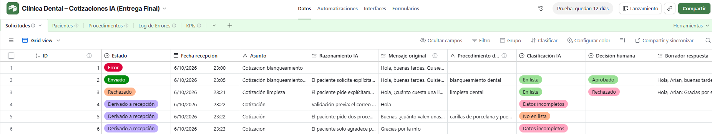

---

## 📁 Estructura del repositorio

```
├── README.md                      ← este documento (propuesta + resumen + evidencias)
├── docs/
│   ├── 01_Diagrama_Arquitectura.pdf
│   ├── 02_Manual_Operativo_Datos.md
│   ├── 03_Matriz_Costos.md
│   ├── 04_Seguridad_Resiliencia.md
│   └── 05_Dashboard_Control.md
├── schemas/                       ← esquemas JSON de transferencia (válidos)
├── workflows/                     ← exportaciones .json de n8n
├── evidencias/                    ← capturas de las pruebas
└── video/
    └── video_demo.mp4             ← demo en vivo (3 min)
```

## ▶️ Cómo importar el flujo

1. En n8n, ve a **Workflows → Import from file** y elige `workflows/flujo_principal_cotizaciones.json`. Repite con el manejador global.
2. Crea las credenciales propias: Gmail OAuth2, Airtable OAuth2, Slack OAuth2 y Anthropic. Los JSON **no traen keys**.
3. Duplica la base de Airtable con la misma estructura (ver el documento 2) y actualiza los IDs en los nodos y en **Configuración del sistema**.
4. En el flujo principal, ve a **Settings → Error Workflow** y elige el manejador global. Luego publica ambos flujos.
